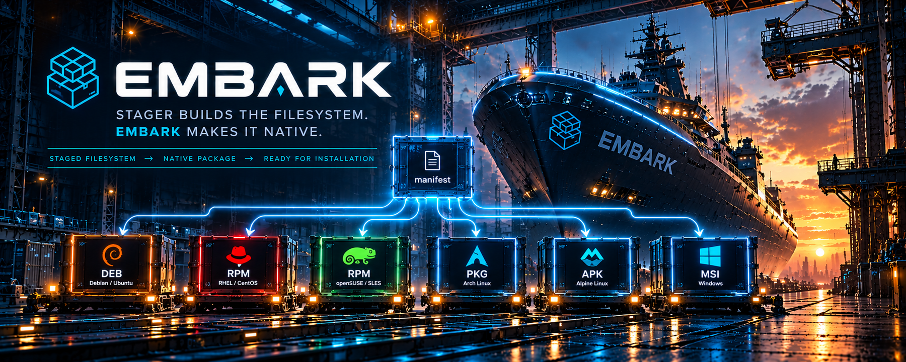

# Embark

<p align="center">
  
</p>

Embark turns a filesystem already prepared by Captain Stager into a native operating-system package.

> Stager builds the filesystem. Embark makes it native.

Embark does not decide where an application's files belong. It receives a staged install root, package metadata, and a small set of native-package transforms, then emits a package for the selected backend.

## Package definition

Both Debian and RPM handlers consume the same canonical package definition. The v1 contract is documented in `schemas/package.schema.json`:

```json
{
  "schema": "embark/package/v1",
  "package": {
    "name": "example",
    "version": "1.0.0",
    "architecture": "x86_64",
    "description": "Example native application",
    "maintainer": "Captain CLI",
    "license": "Proprietary",
    "release": "1",
    "configFiles": [
      "etc/example/config.json"
    ],
    "transforms": [
      {
        "type": "elf-rpath",
        "path": "usr/bin/example",
        "value": "$ORIGIN/../lib/example"
      }
    ]
  }
}
```

The current canonical architecture is `x86_64`. Embark maps it to backend vocabulary (`amd64` for Debian and `x86_64` for RPM).

`configFiles` are translated into native configuration semantics: Debian `conffiles` and RPM `%config(noreplace)` entries.

`elf-rpath` transforms are applied to the materialized package filesystem before package generation. The transform target must remain inside the package root.

## Build packages

```bash
embark deb build \
  --staged /tmp/example-staged \
  --package manifest/embark.package.json

embark rpm build \
  --staged /tmp/example-staged \
  --package manifest/embark.package.json
```

Both commands default `--package` to `embark.package.json` and use `.embark/deb` or `.embark/rpm` as their output workspace.

## Host tooling

The current Linux backends invoke native host tools:

- Debian: `dpkg-deb`
- RPM: `rpmbuild`
- ELF RUNPATH transforms: `patchelf`

These are intended to become Outfit capabilities so Captain can verify/provision packaging prerequisites before invoking Embark.

## Development

```bash
npm test
```

The test command builds TypeScript and runs the Node test suite.
